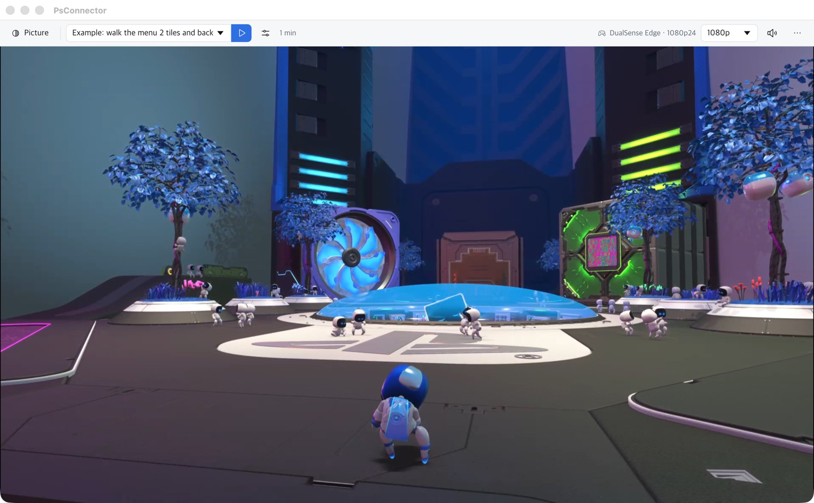

# PsConnector

A PS5 Remote Play client written in Rust. It connects to a PS5 over Remote Play from macOS or Windows, receives the screen and sound, and sends button and stick input.
It is a connection layer that lets game macros and AI assistants operate a PS5.



> Unofficial tool, not affiliated with Sony Interactive Entertainment. PlayStation, PS5 and PS Remote Play are trademarks of Sony.

| Crate | Kind | Purpose |
|---|---|---|
| `psconnector` | library | Session, Takion, controller input, video and audio decoding |
| `psconnector-protocol` | library | The command port protocol (commands, replies) and the shared settings file, used by the window, the MCP server and the replay |
| `psconnector-view` | binary | Screen window, macro command port (8650), macro bar |
| `psconnector-mcp` | binary | MCP server for AI assistants (Claude Code, Codex, ...) |
| `python/psconnector.py` | Python module | Simple interface for writing macros (standard library only) |

## Status

| Feature | Status |
|---|---|
| Console status (DDP) | done |
| Wake from rest mode | done |
| Session setup (init/ctrl auth, control channel, heartbeat) | done |
| Takion stream (INIT → COOKIE → BIG → BANG, ECDH key exchange) | done |
| Button input (last 5 events sent together, plus one re-send of the same packet) | done |
| Stick input (state re-sent every 200 ms) | done (verified with analog recording playback in Code Vein) |
| Rest mode | done |
| Local game controller (DualSense, ...) in psconnector-view | done (gilrs) |
| Video (H.264/H.265, 360p / 720p / 1080p) | done (60 fps at 1080p on the tested Apple Silicon Mac). On macOS both codecs use VideoToolbox (hardware) and the decoded pictures go to the screen without a copy (Metal); openh264 (software) is used elsewhere. Lost units are rebuilt from the FEC units the console sends with every frame; only when that is not enough is a key frame requested |
| Audio (Opus → PCM) | done (pure-Rust Opus decoder, with a faster transform patched in under `third_party/opus-decoder`; lost packets are filled from the copies in the next ones, then by concealment) |
| Finding consoles on the network | done (DDP broadcast) |
| PSN login, PIN registration | done, in the psconnector-view start screen (earlier pyremoteplay registrations are still read) |

## Design

**Only the stream task writes to the socket.** Button and stick commands are passed to it over a channel, and it encrypts and sends them in order. Input from many places at once never shares an encryption position (key_pos).

The `psconnector` library only exposes `Client`, `Button`, `Frame`, `Audio`, `Options`, `StreamConfig`, `Phase` and `Error`, plus the `ddp` (status and wake-up) and `profile` (registration) modules. Errors are a `psconnector::Error` enum, so you can handle cases such as `Error::Busy` (another session connected) or `Error::NotOn` (rest mode) separately.

Internal modules:

| Module | Purpose |
|---|---|
| `net::ddp` | Status and wake-up (UDP 9302) |
| `net::session` | Session setup and control channel (TCP 9295) |
| `crypto::rpcrypt` | Session-stage encryption (AES-CFB) |
| `stream` | Takion connection and the send task (UDP 9296) |
| `net::takion` | Building and parsing Takion packets |
| `crypto::gkcrypt` | Stream-stage encryption (ECDH, key stream, GMAC) |
| `controller` | Button events and stick state data |
| `video` | Video unit assembly with FEC recovery (`video/fec.rs`), decoders: VideoToolbox H.264/H.265 on macOS, openh264 |
| `audio` | Audio packets, frame order and loss recovery, Opus decoder thread |
| `net::proto` | Takion protobuf messages |
| `account::profile` | Registration data (`~/.psconnector/profile.json`; also reads pyremoteplay's `~/.pyremoteplay/.profile.json`) |
| `account::psn` | PSN sign-in through the browser, account id |
| `account::register` | PIN registration with a PS5 |

## Library usage

```rust
use psconnector::{Button, Client};

let client = Client::connect("192.0.2.10", Default::default()).await?;
client.tap(Button::Cross, std::time::Duration::from_millis(80)).await;
// with Options { audio: true, .. }: client.take_audio() gives 10 ms chunks of 16-bit PCM
if let Some(frame) = client.frame() {
    println!("{}x{}", frame.width, frame.height); // frame.rgb: 8-bit RGB
}
client.close().await;
```

Command-line tool for manual checks:

```bash
cargo run -p psconnector --example rp -- 192.0.2.10 status
```

```bash
cargo run -p psconnector --example rp -- 192.0.2.10 tap right right
```

It supports `discover`, `login`, `<host> register <PIN>`, `status`, `wake`, `connect [secs]`, `tap <button>...`, `snap [file]` and `standby`. Build with `--release`, because video decoding is slow in debug builds.

## psconnector-view (screen window + command port)

Shows the PS5 screen in a window and opens a command port for macros (127.0.0.1:8650). It accepts the same commands as the earlier Python `ps5view.py`, so existing macros can switch connection layers without code changes.

```bash
cargo run --release -p psconnector-view
```

Without an address it opens the start screen (or reconnects to the console used last time); `psconnector-view 192.0.2.10` connects to that console directly.

| Command (one JSON object per line) | Reply |
|---|---|
| `{"button":"cross","action":"tap","hold":0.08}` (also `press`, `release`) | `ok` |
| `{"stick":"left","x":0.3,"y":-1}` | `ok` |
| `{"release_all":true}` release every button | `ok` |
| `{"snap":"path.png"}` save the current frame | `ok` |
| `{"screen_snap":"path.png"}` save the composed window, including GPU picture adjustment | `ok` |
| `{"frame":true}` current frame, raw | `ok WIDTH HEIGHT BYTES` followed by raw RGB bytes |
| `{"play":"recording.json"}` / `{"stop":true}` play and stop a recording | `ok` |
| `{"status":true}` | `ok playing` / `ok idle` |
| `{"osd":"text"}` show text in the top-left of the window | `ok` |
| `{"ocr":[x,y,w,h],"scale":2}` read text in a region (macOS Vision); with `"rel":true` the region is `[x0,y0,x1,y1]` fractions | `ok ["line", ...]` |
| `{"standby":true}` rest mode | `ok` |
| `{"macros":true}` / `{"macro_stop":true}` / `{"macro_status":true}` | `ok {JSON}` |
| `{"macro_run":"name","limit_min":60,"after":"standby","at":"23:00"}` (all but the name optional) | `ok started` / `ok scheduled for …` |
| `{"should_stop":true}` has the time limit been reached | `ok yes` / `ok no` |
| `{"input_bench":{}}` / `{"input_bench":{"seconds":12,"interval_ms":10,"burst":4}}` generate below-dead-zone input for latency statistics | `ok input benchmark started ...` |
| `{"picture_snap":"/tmp/shown.png"}` save the current frame with the window's picture adjustment applied | `ok` |
| `{"video_codec":"h264|h265|h265-hdr"}` reconnect with another stream codec (`""` only reports) | `ok reconnecting h265-hdr` |
| `{"video_range":"auto|limited|full"}` override incorrect H.264 range metadata, applied on the GPU so decoding stays in hardware (`""` only reports) | `ok full` |
| `{"picture":{"shadows":0.5,"highlights":0.7}}` / `{"picture":"saved preset name"}` picture adjustment (`""` only reports) | `ok {values}` |
| `{"picture_save":"game name"}` / `{"picture_delete":"game name"}` save or delete the current range and picture controls as one game preset | `ok saved game name` |
| `{"quality":"1080p"}` reconnect at `low` / `720p` / `1080p` (`""` only reports) | `ok {"quality", "width", "height", "reconnecting"}` |

A game controller connected to the computer (DualSense over USB or Bluetooth, Xbox pads, ...) drives the PS5 directly, like the official Remote Play app. Its name shows in the status at the right of the bar. Sticks are only sent when they move, so a pad lying on the desk does not fight a running macro. Start with `--no-pad` to turn this off.

**Picture quality** is picked in the bar or with `--quality low|720p|1080p` (`--bitrate KBPS` to override the bit rate):

| Preset | Stream | Use |
|---|---|---|
| `low` | 640x360, 30 fps, 2 Mbit/s | macros (screen checks, OCR), lightest |
| `720p` | 1280x720, 60 fps, 10 Mbit/s | default |
| `1080p` | 1920x1080, 60 fps, 15 Mbit/s | playing yourself |

The resolution is agreed when connecting, so changing it in the bar reconnects. The console usually releases the old session within a few seconds, but it can occasionally take more than a minute, so expect a wait without a picture. The choice is remembered in `~/.psconnector/settings.json`. Macros keep working across a change: OCR with `rel=` fractions and MCP screenshot regions (always in 1280x720 space) do not depend on the resolution.

On macOS, **Picture → Source → Codec** can request H.264 SDR, hardware-decoded H.265 SDR, or H.265 HDR. The HDR stream is converted to the SDR window with a highlight-preserving display curve; this keeps the HDR source's highlight detail but is not native HDR monitor output. H.265 decoding is currently macOS-only.

**Picture** in the bar opens a panel beside the video: brightness, shadows (lift dark areas), highlights (pull bright areas down), contrast, saturation, warmth and shadow tint (takes a colour cast such as blue out of dark areas), with presets that can be saved and deleted by name. Every new session starts as **Original** (H.264 SDR with no picture adjustment), so one game's correction never leaks into another game. Selecting **Original** later removes the display adjustment instantly. Stream codec is deliberately separate because changing H.264/H.265 requires a full Remote Play reconnect; changing a picture preset never reconnects. Choose the source range, adjust the sliders, then **Save** and type the game name. That preset stores the range and seven picture controls; select it only while playing that game. Add another preset later if a different game needs one. Only what the window shows changes; macros, OCR and screenshots get the console's original frames. Detail the console already clipped to pure white or black cannot come back. When a preset lifts dark tones, the window first smooths the compression blocks that hide there (a deband pass like mpv's, only on dark, nearly flat areas), so lifted shadows do not turn blotchy; H.265 leaves fewer such blocks than H.264.

With the wgpu renderer, the seven picture controls run in a GPU shader; the CPU implementation remains as a fallback and for `picture_snap`. Both use the same integer lookup table so a saved preset keeps the same result when the render path changes. These controls provide live per-game correction, but a preset is not a reference-grade match to another game's colour grading unless it has been calibrated against suitable reference images or a LUT.

### Video performance

The viewer logs decode, queue delay and display timing every 10 seconds. On macOS a decoded frame stays in VideoToolbox's IOSurface-backed pixel buffer (H.264 as YUV 4:2:0 in the stream's own range, H.265 as BGRA); the window wraps it as Metal textures (`CVMetalTextureCache`) and the shader does YUV → RGB with the chosen range and matrix, the HDR → SDR curve, dark-area deband and the picture adjustment once per stream pixel, and a second pass scales the result to the window, so a frame never passes through the CPU. Elsewhere, openh264's RGB is uploaded as it is. RGB for macros, OCR and screenshots is made only when they ask for it (`Frame::rgb()`).

Measured on the development Apple Silicon Mac, 1080p60, release build, PS5 home screen (CPU is the viewer process, 100 % = one core):

| | Before | Now |
|---|---:|---:|
| H.264: decoder / CPU | openh264, ~105–110 % | VideoToolbox, zero-copy, **~22–27 %** |
| H.264 with the colour range picked by hand | openh264, ~105 % | unchanged: still hardware (31 % vs 32 % on auto, same run) |
| H.265 SDR: CPU | ~40 % (0.9 ms/frame conversion) | **~32 %** (zero-copy) |
| H.265 HDR: CPU (HDR → SDR mapping) | ~125 % (2.7 ms/frame) | **~33 %** (zero-copy, on the GPU) |
| Copying decoded frames (A/B, same session conditions, H.264) | ~41 % CPU, 3.1 ms/frame | **~33 %**, 1.3 ms/frame |
| Audio decoding (Opus, stereo 48 kHz) | ~8–10 % of a core | **~1.3 %** (audio on 24.4 % vs `--no-audio` 23.0 %) |
| Display rate | 60 fps | 60 fps |
| 0.5 % of video units lost (test) | 0.3 fps, 142 key frame requests in 40 s | **60 fps, 0 key frame requests** (FEC) |
| Pad report → sent to the console | ~2 ms average (4 ms polling) | **~0.01 ms** (event driven) |
| Audio buffer (sound behind picture) | ~86 ms average (fixed target) | **~35 ms** average (adaptive, no gaps) |

These are implementation measurements, not input-to-photon latency; they vary with the Mac, scene and network (the PS5 home screen alone moves CPU by 5–10 points between runs, so the A/B rows were measured back to back).

Diagnostics (environment variables): `PSCONNECTOR_H264=software` forces openh264; `PSCONNECTOR_DROP_VIDEO=0.005` drops that share of video units on purpose and `PSCONNECTOR_NO_FEC=1` ignores FEC units, to test loss recovery; `PSCONNECTOR_DUMP_VIDEO=file` writes 4000 decrypted video units for the offline FEC check (`PSCONNECTOR_FEC_DUMP=file cargo test -p psconnector --release real_capture -- --ignored`); `PSCONNECTOR_AUDIO_FIXED=1` keeps the old fixed audio buffer.

If the Metal texture cache is unavailable, a frame is converted to RGB on the CPU and uploaded instead (logged at start: `video frames: zero-copy ...` when it is in use).

The PS5's sound plays on the computer's default output device. The buffer that absorbs uneven packet arrival adapts: it starts at 120 ms, comes down to as little as 30 ms while it never gets close to empty, and grows by 40 ms whenever it runs dry; playback speed is nudged by 0.5 % (inaudible) to stay on target instead of skipping, with a windowed-sinc resampler so the treble stays intact. The speaker button in the bar mutes it; `--mute` starts muted and `--no-audio` does not decode it at all.

Whether you quit with Q in the window, Ctrl+C, or SIGTERM, the session is closed cleanly.

### Macro bar

Pick a macro in the run widget at the top of the window and press **▶**; while it runs, the same widget shows its progress and **■** stops it.

**Every folder with a `macro.json` in the `macros` folder next to `psconnector-view` is a macro.** To add one, put its folder there (or link a whole repository) and choose **Reload macro list** in the bar's **⋯** menu. The release archives already have `macros/` beside the program, so the whole folder can be unzipped or moved anywhere, on Windows too. A development build (`target/release/`) reads the repository's `macros/` folder, where your own macros are ignored by git.

```bash
ln -s ~/Project/codevein-macro macros/codevein
```

```json
{"name": "Code Vein farm", "cmd": ".venv/bin/python -u farm.py", "env": {"FARM_GOAL": "400"}, "limit_min": 0, "after": "standby"}
```

Only `cmd` is required. The macro runs in its own folder, so relative paths work and a macro folder can be moved as it is; the name defaults to the folder name. See [macros/README.md](macros/README.md) for every field and [macros/menu-walk](macros/menu-walk) for an example. `--macros PATH` reads other macro folders instead (repeatable; an older list file of `[{"name", "cmd", "cwd"}]` also works).

- Macros run as child processes. The port is passed in the `PSCONNECTOR_PORT` environment variable.
- Stop sends SIGINT first (KeyboardInterrupt in Python) and kills the process if it has not exited after 3 seconds.
- However a macro ends, psconnector-view releases every button and centers both sticks, so nothing stays pressed.
- The run widget shows the run time (and time left), with the last line of the macro's output next to it. Rest mode and Disconnect are in the **⋯** menu.
- `--run NAME` starts a macro right away.

#### Time limit, rest mode afterwards, start time

In the options button next to **▶** (the settings that change what **▶** does stay visible beside it):

- **Limit** (`no limit` / `N min`, drag or type): how long to run. Defaults to `limit_min` from the list.
- **When done: Nothing / Rest mode**: what to do when the macro ends by itself or at its limit. Defaults to `after`. Pressing ■ Stop yourself never triggers it.
- **Start at HH:MM + Schedule**: start later. `23:30` is today (or tomorrow if already past), `+90` is in 90 minutes. While it waits, the run widget shows the start time and **Cancel**.

When the limit is reached, a macro that checks `ps.should_stop()` gets 2 minutes to finish (for example the current lap) and exit; a macro that never checks it is stopped right away. The same options work from the command line and the command port:

```bash
psconnector-view 192.0.2.10 --run "Code Vein" --for 180 --after standby --at 01:00
```

## Python macro interface (`python/psconnector.py`)

A single file that only uses the standard library. No pyremoteplay, pyobjc or OpenCV needed.

```python
from psconnector import PS

ps = PS()                      # started from the psconnector-view bar, the port is passed automatically
ps.osd('starting')
ps.tap('cross')
ps.stick('left', 0, -1); ps.sleep(0.5); ps.stick('left', 0, 0)
w, h, rgb = ps.frame()         # ps.frame_array(bgr=True) if numpy is installed
ps.wait(lambda: ps.pixel(640, 360)[0] > 200, timeout=5)
lines = ps.ocr(rel=(0.38, 0.63, 0.62, 0.75), scale=2)   # text in a region, as a list of lines
if ps.should_stop(): ...       # time limit from the bar reached: finish up and exit
ps.set_quality('low'); ps.wait_ready()   # lighter stream while a macro runs
```

See [macros/menu-walk/menu_walk.py](macros/menu-walk/menu_walk.py) for an example.

## AI integration (MCP server `psconnector-mcp`)

AI assistants with MCP support, such as Claude Code, Claude Desktop and Codex, can see the PS5 screen and control it. No API key is needed; they use your existing subscription. psconnector-view must be running.

```bash
cargo build --release -p psconnector-mcp
```

```bash
claude mcp add psconnector -- /path/to/psconnector/target/release/psconnector-mcp
```

Add `--allow-input` at the end to allow input. By default only viewing the screen, OSD and status work.

| Tool | Purpose | Needs input permission |
|---|---|---|
| `screenshot` | Current screen (zoom into a region, resize) | |
| `console_status` | PS5 on or in rest mode, whether psconnector-view is connected | |
| `osd` | Show text in the psconnector-view window | |
| `macro_list` / `macro_status` / `macro_stop` | Macro list, status and output, stop | |
| `release_all` | Release every button | |
| `tap` / `taps` / `press` / `release` / `stick` | Controller input | ✔ |
| `macro_run` | Run a macro, optionally with a time limit, rest mode afterwards, or a start time | ✔ |
| `quality` | Report or change the picture quality | |
| `standby` / `wake` | Rest mode, wake-up | ✔ |

For example: "Look at the screen and tell me how to beat this boss", "Run the Code Vein farm", "Open the equipment menu".

## Download

Prebuilt binaries for macOS (Apple Silicon and Intel) and Windows (x64) are attached to each [GitHub release](https://github.com/loykin/psconnector/releases). Each archive holds `psconnector-view`, `psconnector-mcp`, the example `macros/` folder and `python/psconnector.py`.

On Windows, the `ocr` command is not supported yet (it uses macOS Vision); everything else works the same. Macros from the bar run through `cmd /C`.

The binaries are not signed. Windows SmartScreen may warn on first run ("More info" → "Run anyway"). On macOS, clear the quarantine flag after extracting:

```bash
xattr -d com.apple.quarantine psconnector-view psconnector-mcp
```

CI (`.github/workflows/ci.yml`) runs rustfmt, clippy, build and tests on macOS and Windows, plus a RustSec dependency audit. Releases are built by `.github/workflows/release.yml` when a `vX.Y.Z` tag matching the workspace version in `Cargo.toml` is pushed on `master`.

## Build

```bash
cargo build --release
```

This produces `psconnector-view` and `psconnector-mcp` in `target/release/`. Release builds are recommended because of video decoding.

## Setup

Nothing else to install. Start `psconnector-view` without an address and its start screen walks through it:

1. **Find**: consoles on the network are listed (on or in rest mode). An address can also be typed in.
2. **Sign in to PSN** (once): Sony's sign-in page opens in a small window inside the app (the system web view: WebKit on macOS, WebView2 on Windows), in a private session that keeps nothing on disk. The password goes only to Sony; when Sony hands back the sign-in code, the window closes by itself. With **use the browser**, the page opens in your web browser instead and you paste the address you land on (`https://remoteplay.dl.playstation.net/remoteplay/redirect?code=...`) back into the app.
3. **Pair** (once per console): on the PS5, Settings → System → Remote Play → Pair Device shows an 8-digit PIN; type it in.
4. **Connect**: a console in rest mode is woken first, then connected.

**Disconnect** (or **Rest mode**) in the bar's **⋯** menu goes back to the start screen. There, **Sign out** (at the bottom) removes the account and its pairings from this computer, and **Forget this PS5** (in a console's **⋯** menu) removes its pairing (each asks once more first). The PS5 keeps this computer in Settings → System → Remote Play → Paired Devices until it is removed there.

The pairing is saved in `~/.psconnector/profile.json` (readable only by you; it holds the keys to the console), and the last console in `~/.psconnector/settings.json`, so the next start connects straight away. A registration made earlier with pyremoteplay is used as well.

On macOS, the first run asks for local network access permission.

## License

MIT
