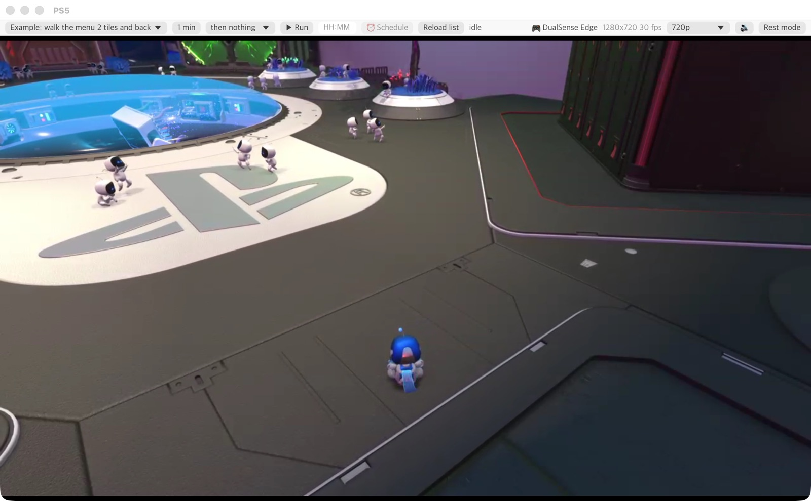

# PsConnector

A PS5 Remote Play client written in Rust. It connects to a PS5 over Remote Play from macOS or Windows, receives the screen and sound, and sends button and stick input.
It is a connection layer that lets game macros and AI assistants operate a PS5.



> Unofficial tool, not affiliated with Sony Interactive Entertainment. PlayStation, PS5 and PS Remote Play are trademarks of Sony.

| Crate | Kind | Purpose |
|---|---|---|
| `psconnector` | library | Session, Takion, controller input, video and audio decoding |
| `psconnector-view` | binary | Screen window, macro command port (8650), macro bar |
| `psconnector-mcp` | binary | MCP server for AI assistants (Claude Code, Codex, ...) |
| `python/psconnector.py` | Python module | Simple interface for writing macros (standard library only) |

## Status

| Feature | Status |
|---|---|
| Console status (DDP) | done |
| Wake from rest mode | done |
| Session setup (init/ctrl auth, control channel, heartbeat) | done |
| Takion stream (INIT → COOKIE → BIG → BANG, ECDH key exchange) | done |
| Button input (last 5 events sent together, plus one re-send of the same packet) | done |
| Stick input (state re-sent every 200 ms) | done (verified with analog recording playback in Code Vein) |
| Rest mode | done |
| Local game controller (DualSense, ...) in psconnector-view | done (gilrs) |
| Video (H.264 → RGB, 360p / 720p / 1080p) | done (openh264 in software, about 58 fps at 1080p on Apple Silicon). Frames with missing units are dropped and a key frame is requested. No FEC recovery yet |
| Audio (Opus → PCM) | done (pure-Rust Opus decoder; lost packets are filled from the copies in the next ones, then by concealment) |
| PSN login, PIN registration | not yet (reads the registration saved by pyremoteplay) |

## Design

**Only the stream task writes to the socket.** Button and stick commands are passed to it over a channel, and it encrypts and sends them in order. Input from many places at once never shares an encryption position (key_pos).

The `psconnector` library only exposes `Client`, `Button`, `Frame`, `Audio`, `Options`, `StreamConfig`, `Phase` and `Error`, plus the `ddp` (status and wake-up) and `profile` (registration) modules. Errors are a `psconnector::Error` enum, so you can handle cases such as `Error::Busy` (another session connected) or `Error::NotOn` (rest mode) separately.

Internal modules:

| Module | Purpose |
|---|---|
| `ddp` | Status and wake-up (UDP 9302) |
| `session` | Session setup and control channel (TCP 9295) |
| `rpcrypt` | Session-stage encryption (AES-CFB) |
| `stream` | Takion connection and the send task (UDP 9296) |
| `takion` | Building and parsing Takion packets |
| `gkcrypt` | Stream-stage encryption (ECDH, key stream, GMAC) |
| `controller` | Button events and stick state data |
| `video` | Video unit assembly, decoder thread (openh264) |
| `audio` | Audio packets, frame order and loss recovery, Opus decoder thread |
| `proto` | Takion protobuf messages |
| `profile` | Reading registration data (`~/.pyremoteplay/.profile.json`) |

## Library usage

```rust
use psconnector::{Button, Client};

let client = Client::connect("192.168.1.20", Default::default()).await?;
client.tap(Button::Cross, std::time::Duration::from_millis(80)).await;
// with Options { audio: true, .. }: client.take_audio() gives 10 ms chunks of 16-bit PCM
if let Some(frame) = client.frame() {
    println!("{}x{}", frame.width, frame.height); // frame.rgb: 8-bit RGB
}
client.close().await;
```

Command-line tool for manual checks:

```bash
cargo run -p psconnector --example rp -- 192.168.1.20 status
```

```bash
cargo run -p psconnector --example rp -- 192.168.1.20 tap right right
```

It supports `status`, `wake`, `connect [secs]`, `tap <button>...`, `snap [file]` and `standby`. Build with `--release`, because video decoding is slow in debug builds.

## psconnector-view (screen window + command port)

Shows the PS5 screen in a window and opens a command port for macros (127.0.0.1:8650). It accepts the same commands as the earlier Python `ps5view.py`, so existing macros can switch connection layers without code changes.

```bash
cargo run --release -p psconnector-view -- 192.168.1.20
```

| Command (one JSON object per line) | Reply |
|---|---|
| `{"button":"cross","action":"tap","hold":0.08}` (also `press`, `release`) | `ok` |
| `{"stick":"left","x":0.3,"y":-1}` | `ok` |
| `{"release_all":true}` release every button | `ok` |
| `{"snap":"path.png"}` save the current frame | `ok` |
| `{"frame":true}` current frame, raw | `ok WIDTH HEIGHT BYTES` followed by raw RGB bytes |
| `{"play":"recording.json"}` / `{"stop":true}` play and stop a recording | `ok` |
| `{"status":true}` | `ok playing` / `ok idle` |
| `{"osd":"text"}` show text in the top-left of the window | `ok` |
| `{"ocr":[x,y,w,h],"scale":2}` read text in a region (macOS Vision); with `"rel":true` the region is `[x0,y0,x1,y1]` fractions | `ok ["line", ...]` |
| `{"standby":true}` rest mode | `ok` |
| `{"macros":true}` / `{"macro_stop":true}` / `{"macro_status":true}` | `ok {JSON}` |
| `{"macro_run":"name","limit_min":60,"after":"standby","at":"23:00"}` (all but the name optional) | `ok started` / `ok scheduled for …` |
| `{"should_stop":true}` has the time limit been reached | `ok yes` / `ok no` |
| `{"quality":"1080p"}` reconnect at `low` / `720p` / `1080p` (`""` only reports) | `ok {"quality", "width", "height", "reconnecting"}` |

A game controller connected to the computer (DualSense over USB or Bluetooth, Xbox pads, ...) drives the PS5 directly, like the official Remote Play app. Its name shows at the right of the bar. Sticks are only sent when they move, so a pad lying on the desk does not fight a running macro. Start with `--no-pad` to turn this off.

**Picture quality** is picked in the bar or with `--quality low|720p|1080p` (`--bitrate KBPS` to override the bit rate):

| Preset | Stream | Use |
|---|---|---|
| `low` | 640x360, 30 fps, 2 Mbit/s | macros (screen checks, OCR), lightest |
| `720p` | 1280x720, 60 fps, 10 Mbit/s | default |
| `1080p` | 1920x1080, 60 fps, 15 Mbit/s | playing yourself |

The resolution is agreed when connecting, so changing it in the bar reconnects. The console takes anywhere from a few seconds to about 40 to release the old session, so expect a short wait without a picture. The choice is remembered in `~/.psconnector/settings.json`. Macros keep working across a change: OCR with `rel=` fractions and MCP screenshot regions (always in 1280x720 space) do not depend on the resolution.

The PS5's sound plays on the computer's default output device, kept within about 0.1 s of the picture. 🔊 in the bar mutes it; `--mute` starts muted and `--no-audio` does not decode it at all.

Whether you quit with Q in the window, Ctrl+C, or SIGTERM, the session is closed cleanly.

### Macro bar

Pick a macro in the bar at the top of the window and press **▶ Run / ■ Stop**.

**Every folder with a `macro.json` in the `macros` folder next to `psconnector-view` is a macro.** To add one, put its folder there (or link a whole repository) and press **Reload list**. The release archives already have `macros/` beside the program, so the whole folder can be unzipped or moved anywhere, on Windows too. A development build (`target/release/`) reads the repository's `macros/` folder, where your own macros are ignored by git.

```bash
ln -s ~/Project/codevein-macro macros/codevein
```

```json
{"name": "Code Vein farm", "cmd": ".venv/bin/python -u farm.py", "env": {"FARM_GOAL": "400"}, "limit_min": 0, "after": "standby"}
```

Only `cmd` is required. The macro runs in its own folder, so relative paths work and a macro folder can be moved as it is; the name defaults to the folder name. See [macros/README.md](macros/README.md) for every field and [macros/menu-walk](macros/menu-walk) for an example. `--macros PATH` reads other macro folders instead (repeatable; an older list file of `[{"name", "cmd", "cwd"}]` also works).

- Macros run as child processes. The port is passed in the `PSCONNECTOR_PORT` environment variable.
- Stop sends SIGINT first (KeyboardInterrupt in Python) and kills the process if it has not exited after 3 seconds.
- However a macro ends, psconnector-view releases every button and centers both sticks, so nothing stays pressed.
- The bar shows the run time and the last line of the macro's output, with a rest-mode button on the right.
- `--run NAME` starts a macro right away.

#### Time limit, rest mode afterwards, start time

Next to the macro picker:

- **Limit** (`no limit` / `N min`, drag or type): how long to run. Defaults to `limit_min` from the list.
- **then nothing / then rest mode**: what to do when the macro ends by itself or at its limit. Defaults to `after`. Pressing ■ Stop yourself never triggers it.
- **HH:MM + ⏰ Schedule**: start later. `23:30` is today (or tomorrow if already past), `+90` is in 90 minutes. **Cancel schedule** or ■ Stop cancels it.

When the limit is reached, a macro that checks `ps.should_stop()` gets 2 minutes to finish (for example the current lap) and exit; a macro that never checks it is stopped right away. The same options work from the command line and the command port:

```bash
psconnector-view 192.168.1.20 --run "Code Vein" --for 180 --after standby --at 01:00
```

## Python macro interface (`python/psconnector.py`)

A single file that only uses the standard library. No pyremoteplay, pyobjc or OpenCV needed.

```python
from psconnector import PS

ps = PS()                      # started from the psconnector-view bar, the port is passed automatically
ps.osd('starting')
ps.tap('cross')
ps.stick('left', 0, -1); ps.sleep(0.5); ps.stick('left', 0, 0)
w, h, rgb = ps.frame()         # ps.frame_array(bgr=True) if numpy is installed
ps.wait(lambda: ps.pixel(640, 360)[0] > 200, timeout=5)
lines = ps.ocr(rel=(0.38, 0.63, 0.62, 0.75), scale=2)   # text in a region, as a list of lines
if ps.should_stop(): ...       # time limit from the bar reached: finish up and exit
ps.set_quality('low'); ps.wait_ready()   # lighter stream while a macro runs
```

See [macros/menu-walk/menu_walk.py](macros/menu-walk/menu_walk.py) for an example.

## AI integration (MCP server `psconnector-mcp`)

AI assistants with MCP support, such as Claude Code, Claude Desktop and Codex, can see the PS5 screen and control it. No API key is needed; they use your existing subscription. psconnector-view must be running.

```bash
cargo build --release -p psconnector-mcp
```

```bash
claude mcp add psconnector -- /path/to/psconnector/target/release/psconnector-mcp
```

Add `--allow-input` at the end to allow input. By default only viewing the screen, OSD and status work.

| Tool | Purpose | Needs input permission |
|---|---|---|
| `screenshot` | Current screen (zoom into a region, resize) | |
| `console_status` | PS5 on or in rest mode, whether psconnector-view is connected | |
| `osd` | Show text in the psconnector-view window | |
| `macro_list` / `macro_status` / `macro_stop` | Macro list, status and output, stop | |
| `release_all` | Release every button | |
| `tap` / `taps` / `press` / `release` / `stick` | Controller input | ✔ |
| `macro_run` | Run a macro, optionally with a time limit, rest mode afterwards, or a start time | ✔ |
| `quality` | Report or change the picture quality | |
| `standby` / `wake` | Rest mode, wake-up | ✔ |

For example: "Look at the screen and tell me how to beat this boss", "Run the Code Vein farm", "Open the equipment menu".

## Download

Prebuilt binaries for macOS (Apple Silicon and Intel) and Windows (x64) are attached to each [GitHub release](https://github.com/loykin/psconnector/releases). Each archive holds `psconnector-view`, `psconnector-mcp`, the example `macros/` folder and `python/psconnector.py`.

On Windows, the `ocr` command is not supported yet (it uses macOS Vision); everything else works the same. Macros from the bar run through `cmd /C`.

The binaries are not signed. Windows SmartScreen may warn on first run ("More info" → "Run anyway"). On macOS, clear the quarantine flag after extracting:

```bash
xattr -d com.apple.quarantine psconnector-view psconnector-mcp
```

CI (`.github/workflows/ci.yml`) runs rustfmt, clippy, build and tests on macOS and Windows, plus a RustSec dependency audit. Releases are built by `.github/workflows/release.yml` when a `vX.Y.Z` tag matching the workspace version in `Cargo.toml` is pushed on `master`.

## Build

```bash
cargo build --release
```

This produces `psconnector-view` and `psconnector-mcp` in `target/release/`. Release builds are recommended because of video decoding.

## Setup

- Register once with pyremoteplay (for example via ps5rmtctl) to log in to PSN and pair the PS5. That registration data is read as is.
- On macOS, the first run asks for local network access permission.

## References

The protocol behavior was checked against [chiaki](https://git.sr.ht/~thestr4ng3r/chiaki) and [pyremoteplay](https://github.com/ktnrg45/pyremoteplay). The crypto is compared byte for byte with pyremoteplay output in `psconnector/src/crypto_tests.rs`.

The session key tables in `psconnector/src/keys.rs` come from the official Remote Play app.

## License

MIT
