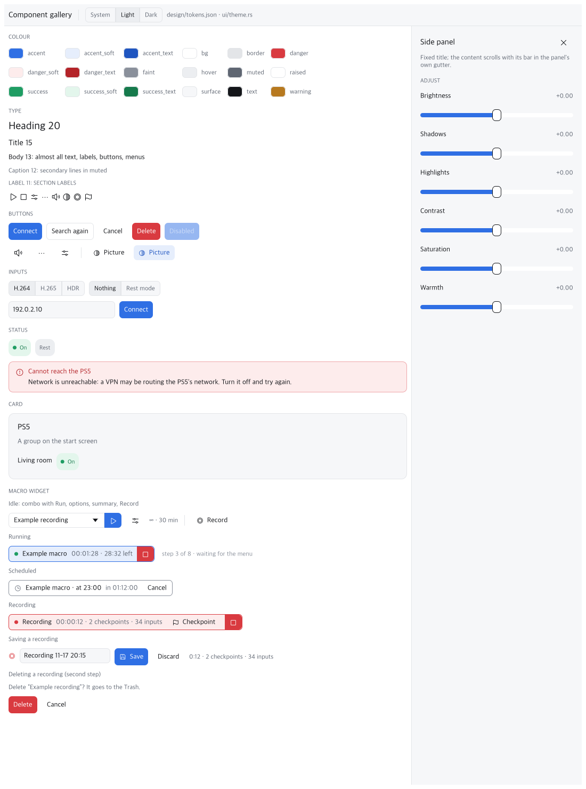
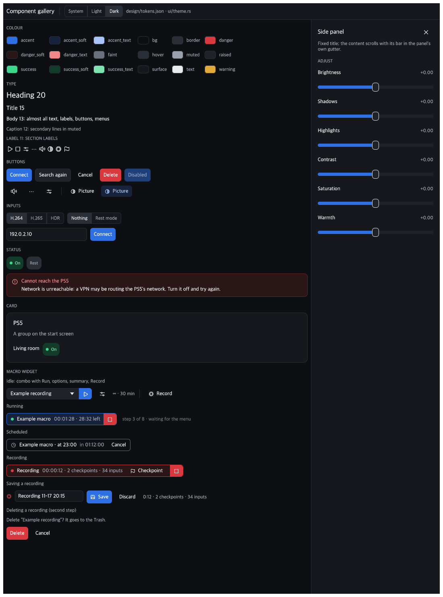

# PsConnector design system

The look of psconnector-view and of any web page that goes with it (macro reports, trackers). One set of tokens, a small set of components, and the rules for using them.

| File | What it is |
|---|---|
| [`tokens.json`](tokens.json) | **The source.** Colours (dark and light), sizes, fonts and icon codepoints, in the W3C design tokens (DTCG) format with token sets `core`, `dark` and `light`, as Figma Tokens Studio reads and writes it. Change values here only. |
| `crates/psconnector-view/build.rs` | Generates the Rust constants (`Tokens`, `size`, `icon`) for `ui::theme` from `tokens.json` at build time. |
| [`tokens.css`](tokens.css) | The same tokens as CSS custom properties (`--ps-*`) for web pages. Generated; a test fails when it is out of date. |
| `crates/psconnector-view/src/ui/theme.rs` | The egui components built on the tokens. Screens use only these. |

## Seeing it: the component gallery

Every token, every component and every state of the bar's macro widget on one screen, without a PS5:

```bash
cargo run --release -p psconnector-view -- --gallery
```

The same screen is kept as images, so a change in the look shows up as an image diff:

| Light | Dark |
|---|---|
|  |  |

```bash
# compare the current look with the saved images (renders with the GPU, so not part of a normal test run)
cargo test -p psconnector-view gallery -- --ignored
# after an intended change: save new images
UPDATE_SNAPSHOTS=1 cargo test -p psconnector-view gallery -- --ignored
```

A new component goes into the gallery (`crates/psconnector-view/src/ui/gallery.rs`) as well as into `ui::theme`; a state of a bar widget is drawn by a plain view function (`running_strip`, `recording_strip`, …) that both the bar and the gallery call.

### With Figma

`tokens.json` is a Tokens Studio file: point the plugin's sync at this repository's `design/tokens.json` (single file, token sets `core`, `dark`, `light`; themes Dark and Light). A designer edits colours and sizes in Figma and pushes them as a change to this file; the build turns them into the viewer's constants and `tokens.css`, and the gallery images show the result. Component shapes are code (`ui::theme`), drawn from a design and reviewed through the gallery.

After editing `tokens.json`:

```bash
UPDATE_DESIGN_TOKENS=1 cargo test -p psconnector-view tokens
```

## Principles

- **Dark first.** The streaming window is dark by nature, so the dark palette is the reference; light follows the system setting.
- **The picture is the product.** Chrome stays thin: one bar on top, panels at the side, nothing over the video except the macro's own text.
- **What is used while playing stays in the bar; the rest goes one level down** (a popover or the ⋯ menu), like an IDE's main toolbar.
- **One widget per job, whose contents follow its state** (idle → running → recording), so states never compete for space.
- **The same on macOS and Windows.** Everything is drawn by egui with these tokens; no native widgets.

## Tokens

### Colour

Every colour has a role; pick by role, never by hex.

| Token | Role | Dark | Light |
|---|---|---|---|
| `bg` | window background (start screen) | `#0E0F12` | `#FFFFFF` |
| `surface` | bars, side panels, cards, fields | `#16181D` | `#F6F7F9` |
| `raised` | controls, menus, popovers | `#1F2229` | `#FFFFFF` |
| `hover` | hovered or selected control; neutral badge | `#2A2E37` | `#ECEEF1` |
| `border` | 1px lines: separators, control and card borders | `#2A2E37` | `#E3E5E8` |
| `text` | body text | `#E8EAED` | `#14161A` |
| `muted` | secondary text, captions, section labels | `#9AA0AB` | `#5F6672` |
| `faint` | least important text (last log line) | `#6B717C` | `#8A909B` |
| `accent` | primary button, selection, running state | `#2F6FE4` | `#2F6FE4` |
| `accent_soft` | accent background (toggled button, running strip) | `#17233A` | `#E6EEFC` |
| `accent_text` | accent text on a neutral background, links | `#A9C4F8` | `#1F55C0` |
| `danger` | destructive button, recording, stop | `#D93A40` | `#D93A40` |
| `danger_soft` | danger background (banner, recording strip) | `#2A1517` | `#FDECEC` |
| `danger_text` | danger text | `#F0868A` | `#B42328` |
| `success` | status dot: on, running | `#3DD68C` | `#1F9D63` |
| `success_soft` | success background (badge) | `#133B29` | `#E3F6EC` |
| `success_text` | success text | `#7EE2B1` | `#167A4C` |
| `warning` | warnings | `#E2A93B` | `#B7791F` |

Each state colour comes as a trio: the solid colour (`danger`) for fills and dots, `*_soft` for the background of a strip or badge, `*_text` for text on that background.

### Size (points = CSS px)

| Token | Value | Used for |
|---|---|---|
| `control` | 28 | height of everything in the bar and in popovers |
| `form` | 32 | height of buttons and fields in forms (start screen) |
| `radius` | 6 | controls |
| `panel_radius` | 10 | cards, menus, popovers |
| `label` / `caption` / `body` / `title` / `heading` | 11 / 12 / 13 / 15 / 20 | type scale |
| `panel_pad` | 16 | padding inside side panels and cards |
| `gap` | 8 | space between items |
| `icon` | 16 | icon glyphs in buttons |
| `scroll_bar` / `scroll_gap` | 6 / 4 | scroll bar width and its gap to the content |

### Type and icons

- Text: the system Korean font (Apple SD Gothic Neo on macOS, Malgun Gothic on Windows).
- Icons: [Phosphor](https://phosphoricons.com) regular, embedded (`assets/Phosphor.ttf`, MIT). Icons are text, so they take the text colour and line up with labels. Codepoints are in `tokens.json` `icon`; add new ones there.
- Section labels are upper-case at `label` size, bold, `muted`.

## Components (`ui::theme`)

| Component | When |
|---|---|
| `primary` | the one main action of a screen or group (accent fill, white bold text) |
| `secondary` | other actions in a form |
| `ghost` | low-emphasis actions; no frame until hovered (Cancel, Discard) |
| `destructive` | actions that delete or end something (danger fill) |
| `icon_button` | square icon-only button in the bar; the tooltip names it |
| `toggle_button` | icon + label that opens something; `accent_soft` while it is open (Picture) |
| `segmented` | one of 2–4 options as joined buttons (Codec, Range, When done) |
| `field` | single-line text input, as tall as the buttons beside it, text centred vertically |
| `badge` | small state label (On / Rest); `Tone::Success` adds a dot |
| `status_dot` | 7px state dot |
| `banner` | a problem the user can act on (danger_soft box, warning icon, title, text) |
| `section_label` | upper-case label over a group of controls |
| `vsep` | thin vertical divider between groups in the bar |
| `card` | bordered group with a title (start screen) |
| `side_panel` | right-hand panel: fixed title row with a close button, content that scrolls in its own gutter |

## Patterns

### The bar

Every state of the macro widget below is drawn in the gallery (Macro widget section).

- Order: **Picture** · divider · **macro widget** · (right) caption with controller and stream · quality · sound · **⋯**.
- Everything is `control` (28) tall on the `surface` fill.
- The macro widget is one control whose contents follow its state:
  - **idle**: combo joined to a Run end button (`accent`), options popover, summary caption, Record;
  - **running**: a strip with an `accent` border on `accent_soft`, a status dot, name, times and a Stop end button (`danger`); the last log line follows in `faint`;
  - **recording**: the same strip in `danger` / `danger_soft`, with Checkpoint and Stop;
  - **saving a recording**: a name field, Save (`primary`) and Discard (`ghost`).
- Rare or disruptive actions (reload list, disconnect, rest mode) live in **⋯**; rest mode is in `danger_text`.

### Side panel

The gallery's right-hand column is a side panel.

- 320 wide, `surface` fill, `panel_pad` padding.
- The title row (title + close) and a caption stay fixed; the content scrolls.
- **The scroll bar has its own gutter** (`scroll_bar` + `scroll_gap`) in the panel's right padding: it never covers sliders or buttons, and the content ends at the same edge as the title whether or not it scrolls. The handle stays faintly visible so it is clear the panel scrolls.
- Inside: `section_label` per group, controls in a grid of label + control.

### Popovers

- Open from an icon button in the bar (options) and close on a click outside.
- `panel_radius` corners, `raised` fill, a `section_label` on top, a grid of label + control, and one line at the bottom saying what the settings will do.

### Destructive actions

- Always a second step in place (no system dialog): the first click turns the item into "Delete …? Delete / Cancel"; the delete is `destructive`, cancel is `ghost`.

## Web pages

Link the generated CSS (or paste it into the page's `<style>`), then use the variables:

```css
body { background: var(--ps-bg); color: var(--ps-text); font: var(--ps-body)/1.5 var(--ps-font-text); }
.card { background: var(--ps-surface); border: 1px solid var(--ps-border); border-radius: var(--ps-panel-radius); padding: var(--ps-panel-pad); }
.button.primary { background: var(--ps-accent); color: #fff; height: var(--ps-form); border-radius: var(--ps-radius); }
```

`tokens.css` puts the light palette on `:root` and the dark one under `prefers-color-scheme: dark` and `[data-theme="dark"]`, so pages follow the viewer's system setting the way the app does.

## Adding to it

- A new colour or size goes into `tokens.json` as a token with `$type`, `$value` and its role in `$description`, then regenerate.
- A new component goes into `ui::theme`, built only from tokens, gets a row in the table above and a place in the gallery; then refresh the gallery images.
- Screens never hard-code a colour or a size; if one is missing, it is missing from the tokens.
